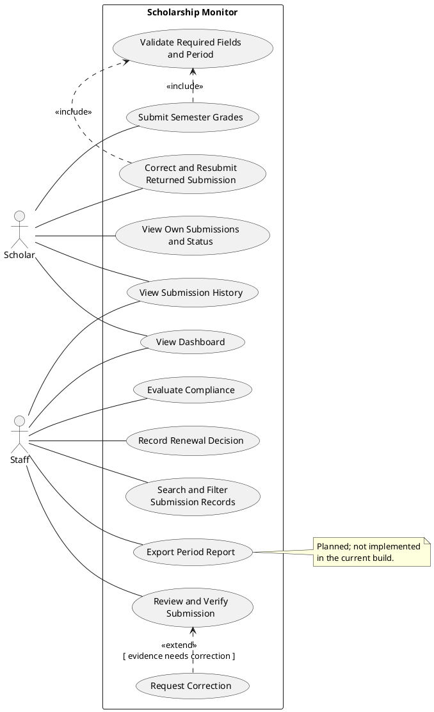
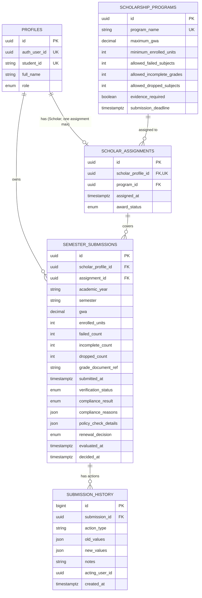

# Part I — Analysis and Design

**System:** Scholarship Monitor  
**Baseline status:** Requirements baseline for the current build; planned gaps are identified in A6.  
**Terms:** A *submission* is a Scholar's semester academic summary and evidence reference. Verification, academic compliance, renewal decision, and award status are separate states.

## A1. Investigation and planning

### Problem statement

Scholarship staff need a consistent way to receive semester academic summaries, check evidence, apply the correct program policy, and record renewal decisions. When records, thresholds, and decisions are handled separately, review is slow and difficult to audit. Scholarship Monitor centralizes these records and workflow steps; the Registrar remains the source of official grades, and the application does not release payments.

### Problem causes and effects

| ID | Cause | Effect |
|---|---|---|
| PC01 | Academic summaries and evidence references arrive through separate channels. | Staff spend time locating and reconciling records. |
| PC02 | Programs have different academic thresholds and deadlines. | Applying the wrong policy can produce inconsistent compliance results. |
| PC03 | Verification, compliance, and renewal decisions are treated as one outcome. | A deficient result can be mistaken for an automatic award cancellation. |
| PC04 | Corrections and decisions are not consistently recorded with their actors and times. | Review history and accountability are incomplete. |

### Scope and exclusions

**In scope:** Scholar and Staff access; Scholar submission and correction of semester summaries; evidence-reference verification; evaluation against the Scholar's assigned program policy; Staff renewal decisions; searchable records, dashboard summaries, and action history.

**Out of scope:** Official grade retrieval from the Registrar, evidence-file hosting or content validation, payment processing, SMS, appeals or policy exceptions, machine learning, and in-app policy authoring. Policy rows are configured outside the application. The current build does not provide a downloadable/formal report.

### Development tasks

1. Confirm program thresholds, deadlines, evidence requirements, and decision authority with the Scholarship Office.
2. Implement stable-ID data entities, integrity constraints, access controls, and auditable workflow operations.
3. Build Scholar submission/correction and Staff verification/evaluation/decision screens.
4. Validate role restrictions, policy boundaries, duplicate handling, status separation, and deployment configuration.

### Risks and responses

| ID | Risk | Response |
|---|---|---|
| RK01 | An outdated or incorrectly configured policy leads to a misleading evaluation. | Restrict policy configuration to authorized administrators; show and retain the policy snapshot used for each evaluation; review policy data before each period. |
| RK02 | A document reference is mistaken for verified official evidence. | Keep evidence verification as an explicit Staff action; label the app as a summary/reference tracker and retain the Registrar as the official source. |

## A2. Stakeholders and elicitation

| Stakeholder | Interest | Actual system actor? |
|---|---|---|
| Scholar / scholarship recipient | Submit academic summaries, correct returned records, and track status. | **Yes — Scholar** |
| Scholarship Staff / reviewer | Verify evidence, evaluate compliance, and record renewal decisions. | **Yes — Staff** |
| Scholarship Office lead / program administrator | Define policy, oversee award administration, and review aggregate outcomes. | No separate actor in the current build; policy setup is external. |
| Registrar | Maintain official academic records and answer grade-record questions. | No; external source of official grades, not integrated. |

### Open-ended elicitation questions

1. **Verification:** What evidence must a Scholar provide, and how should Staff distinguish a verifiable document reference from evidence that must be returned?
2. **Verification:** What verification outcomes, reasons, and review steps are needed before a submission can be evaluated?
3. **Deadlines:** How are deadlines set for each program and semester, including the time zone and treatment of submissions received exactly at the deadline?
4. **Policy exceptions:** Which policy exceptions or appeals may be requested, who can authorize them, and how must the rationale be recorded?
5. **Access:** Which Scholar and Staff actions and records should each role be allowed to view or change, including account creation and program assignment?
6. **Reports:** Which period, program, compliance, verification, and renewal measures should reports contain, who may access them, and what export formats are required?

## A3. Requirements and rules

### Functional requirements

| ID | Requirement |
|---|---|
| FR01 | The system shall authenticate users and enforce the Scholar or Staff role for every protected read and workflow action. |
| FR02 | A Scholar with an active scholarship assignment shall be able to submit an academic year, semester, GWA, enrolled units, failed/incomplete/dropped counts, and non-empty evidence reference. The system shall timestamp the submission and set verification to Pending, compliance to Not Evaluated, and renewal to Undecided. |
| FR03 | The system shall reject a second submission for the same Scholar, academic year, and semester, and reject values outside the defined field constraints. |
| FR04 | Staff shall be able to verify a submission or return it with a required correction reason; a verified submission shall require an evidence reference. |
| FR05 | The owner of a Returned submission shall be able to correct and resubmit it. The system shall reset verification, compliance, and renewal outcomes and retain the prior actions in history. |
| FR06 | Staff shall be able to evaluate only a Verified submission against the policy of its assigned scholarship program. The system shall show the checks, result, reasons, and policy snapshot used. |
| FR07 | Staff shall be able to record a renewal decision only after verification and evaluation; approval shall require Compliant, and a Held decision shall require a reason. |
| FR08 | Scholars shall be able to view only their own assignment, submissions, outcomes, and history; Staff shall be able to search and filter submissions by academic period, Scholar, program, and compliance result. |
| FR09 | The system shall provide dashboard summaries for the current reporting period and an action history for each submission, including action, timestamp, actor where available, and notes. |
| FR10 | **Planned / not implemented:** Authorized users shall be able to produce and download a period report containing submission, verification, compliance, and renewal totals, filterable by program and academic period. |

### Non-functional requirements

| ID | Requirement |
|---|---|
| NFR01 | For a supported modern desktop browser and a network round-trip of at most 200 ms, dashboard and filtered-list views shall render within 3 seconds for up to 1,000 submissions. |
| NFR02 | All protected data reads and workflow mutations shall be authorized server-side; a Scholar request for another Scholar's records or Staff-only action shall return no protected data and shall not mutate data. |
| NFR03 | Every successful submission, correction, verification, evaluation, or renewal decision shall have a corresponding history record committed in the same database transaction. |
| NFR04 | All time comparisons shall use stored timezone-aware timestamps; a submission at the configured deadline shall pass the deadline check, while one later than the deadline shall fail it. |

### Business rules

| ID | Rule |
|---|---|
| BR01 | Evaluation shall use the policy thresholds and deadline belonging to the Scholar's assigned scholarship program: GWA must be at or below the maximum; enrolled units at or above the minimum; failed, incomplete, and dropped counts at or below their allowed maxima. |
| BR02 | The submission deadline is inclusive: submitted time equal to the deadline passes; only a later timestamp fails. |
| BR03 | There may be at most one submission per Scholar + academic year + semester. |
| BR04 | Evidence verification is distinct from compliance evaluation. Evaluation is allowed only after verification is Verified; a Returned submission must include a correction reason. |
| BR05 | Only Staff may verify, evaluate, or decide renewal. Renewal approval requires a Verified, Compliant submission; a Held decision requires a reason. |
| BR06 | Verification status, compliance result, renewal decision, and award status are independent. A Verified submission may be With Deficiency while the award remains Active; a compliance flag alone must not change award status or automatically disqualify a Scholar. |

## A4. UML use-case model

Authentication is a precondition for protected use cases, not a repeated included use case. The two actors below are the application's mandatory roles.

**Relationship rationale**

- **UC01 and UC02 include UC09:** validating required fields and the academic period is mandatory for both initial submissions and corrections; the shared validation is not an optional outcome.
- **UC11 extends UC05:** requesting correction is conditional on Staff finding evidence that needs correction, at the verification outcome. The extension arrow points from the conditional behavior to its base use case.

## A5. Detailed use cases and data design

### UC01 — Submit Grades

- **Primary actor:** Scholar
- **Trigger:** Scholar selects *Submit grades* and sends the semester form.
- **Preconditions:** Scholar is authenticated; profile role is Scholar; an active scholarship assignment exists.
- **Main flow:**
  1. System presents the academic year, semester, GWA, enrolled units, failed/incomplete/dropped counts, and evidence-reference fields.
  2. Scholar enters the academic summary and evidence reference and submits.
  3. System validates required fields and allowed formats/ranges.
  4. System identifies the Scholar's active assignment and creates the submission with a server timestamp.
  5. System sets verification to Pending, compliance to Not Evaluated, and renewal to Undecided.
  6. System records the submission action in history and confirms receipt.
- **Alternative flows:**
  - **A1 — Duplicate period:** At step 4, the Scholar/year/semester key already exists; the system rejects the new row and reports the duplicate.
  - **A2 — Invalid input:** At step 3, a required value is missing or outside its allowed range; the system reports the validation error and creates no submission.
- **Exception flows:**
  - **E1 — No active assignment:** At step 4, no active assignment exists; submission is rejected with an actionable error.
  - **E2 — Persistence or network failure:** The system reports the error and does not display a success confirmation.
- **Postcondition:** One pending submission exists with the captured values, server timestamp, and a history entry; otherwise, no new submission is created.
- **Linked requirements/rules:** FR02, FR03; BR03.

### UC06 — Evaluate Compliance

- **Primary actor:** Staff
- **Trigger:** Staff opens a verified submission and selects *Evaluate compliance*.
- **Preconditions:** Staff is authenticated; submission exists; verification status is Verified; its assignment and program policy are available.
- **Main flow:**
  1. System loads the submission and the policy for its assigned program.
  2. System compares GWA, enrolled units, failed, incomplete, and dropped counts to their policy thresholds.
  3. System compares the server-recorded submission timestamp with the policy deadline.
  4. System records each check and the policy snapshot used.
  5. System sets compliance to Compliant when all checks pass, otherwise With Deficiency, and records reason(s), evaluator, and time.
  6. System records the evaluation in history and displays the result and checks to Staff.
- **Alternative flows:**
  - **A1 — One or more failed checks:** At step 5, the system sets With Deficiency and lists every failed threshold/deadline check; Staff may still make a separate renewal decision under UC07.
- **Exception flows:**
  - **E1 — Not Verified:** At step 1, evaluation is rejected and the compliance state is unchanged.
  - **E2 — Missing policy/assignment:** Evaluation is rejected with an explicit error; no result is written.
  - **E3 — Unauthorized role:** A non-Staff request is rejected with no mutation.
- **Postcondition:** The verified submission has a recorded compliance outcome, policy snapshot, reasons, evaluator/time, and history record; renewal remains a separate Staff decision.
- **Linked requirements/rules:** FR06, FR07; BR01, BR02, BR04, BR05, BR06.

### Core entity relationship diagram

`SEMESTER_SUBMISSIONS` additionally stores verification reason/actor/time, renewal notes/actor/time, and creation/update timestamps. A database unique constraint enforces `(scholar_profile_id, academic_year, semester)`; a composite foreign key ensures the assignment belongs to the same Scholar. `SUBMISSION_HISTORY.acting_user_id` references the authenticated actor when available.

## A6. Traceability map

The test IDs refer to the TC01–TC10 cases documented in the project README. They are expected-result checks, **not evidence of successful execution**: hosted database/API tests have not been run in this workspace.

| Requirement | Actor | Use case | Rule | Implemented screen/function | Test and expected result |
|---|---|---|---|---|---|
| FR02 Submit academic summary | Scholar | UC01 | BR03 | *Submit semester grades* form; `submit_semester_submission` | **TC07:** valid submission creates one record; invalid GWA/count and duplicate period are rejected without an invalid/duplicate row. |
| FR04 Verify or return evidence | Staff | UC05 | BR04, BR05 | Submission detail verification form; `set_submission_verification` | **TC08:** Scholar cannot invoke Staff verification; authorization fails and no state changes. |
| FR06 Evaluate using assigned policy | Staff | UC06 | BR01, BR02 | Submission detail *Evaluate compliance* action; `evaluate_submission` | **TC01 / TC02:** A01 at its deadline and within thresholds evaluates Compliant; A02 above maximum GWA evaluates With Deficiency with a GWA reason. |
| FR07 Record renewal decision separately | Staff | UC07 | BR05, BR06 | Submission detail renewal form; `decide_renewal` | **TC10:** Staff can approve a compliant submission and hold a deficient one with a reason; Scholar cannot decide; compliance does not automatically alter award status. |

### Planned requirements not implemented

- **FR10 / UC12 — Export Period Report:** the current dashboard and submission list provide on-screen metrics and filters, but no report download/export action exists.
- Policy administration, exception/appeal processing, and evidence-file upload are also outside the current build scope (see A1).

